# Experiment 001: Comparison report

Three ways to build the same destructible house, compared on the same scenario. The versions share the floor plan, scale, speeds, gun, enemy, spawn rate, navigation grid and enemy brain. Only the way the house is built, drawn and broken differs.

- **A: True 3D Voxels** (`src/voxel/`, notes in `voxel.md`)
- **B: Modular 3D** (`src/modular/`, notes in `modular.md`)
- **C: Illustrated 2D** (`src/illustrated/`, notes in `illustrated.md`)

**How this was checked.** Every screenshot comes from the real game camera and the real Godot 4.7.2 renderer. It ran under software Vulkan (lavapipe) on a headless Linux VM, so frame rates here are 1–8 fps and **say nothing about a real GPU**. Judge performance by the draw calls and CPU timings below. Each version passed the headless smoke contract and an end-to-end playtest driven by real input events (launcher key, WASD, mouse aim with LMB held, zoom, N, R, Esc). **No person has played any version with a real mouse and keyboard**, so feel (aim, pacing, satisfaction) is not verified. No executable was exported.

Labels used below: **[D]** demonstrated in this build · **[F]** looks technically feasible but was not implemented · **[U]** uncertain.

## Same situation, three technologies

Every shot below comes from `tools/compare.sh`, which plays the same script in each version:

1. Blow a walk-through hole in the south wall with the same 12-shot pattern.
2. Shatter the eastern of the two south living-room windows.
3. Chip the bedroom wall four times.
4. Spawn three psychos at the same points.
5. Place the player in the living room, aiming at the hole.
6. Toggle night.

| | Day | Night |
|---|---|---|
| **A Voxels** | 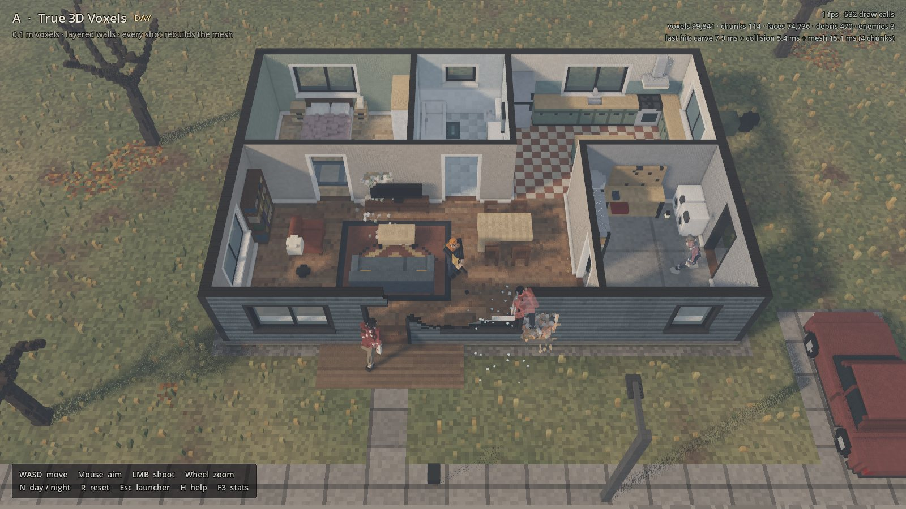 | 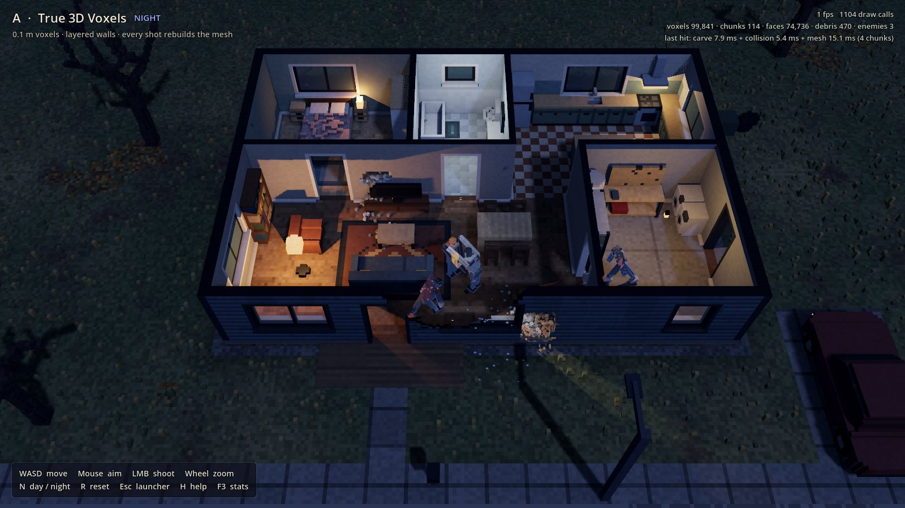 |
| **B Modular** | 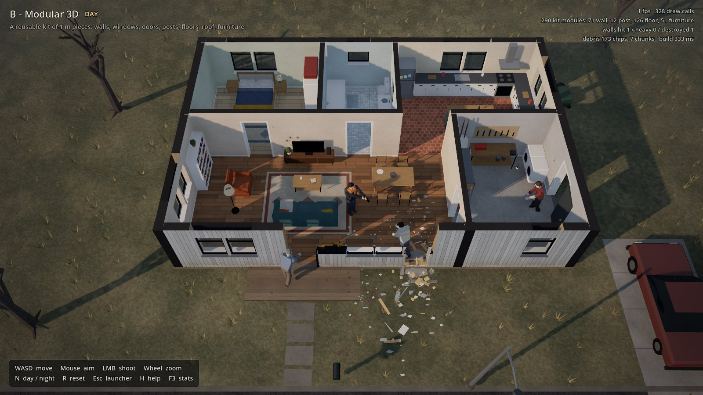 | 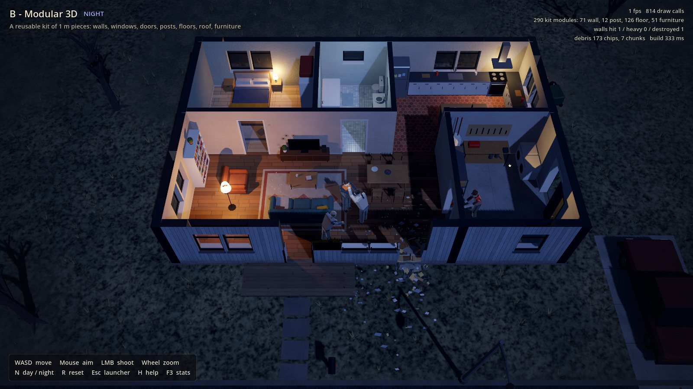 |
| **C Illustrated** | 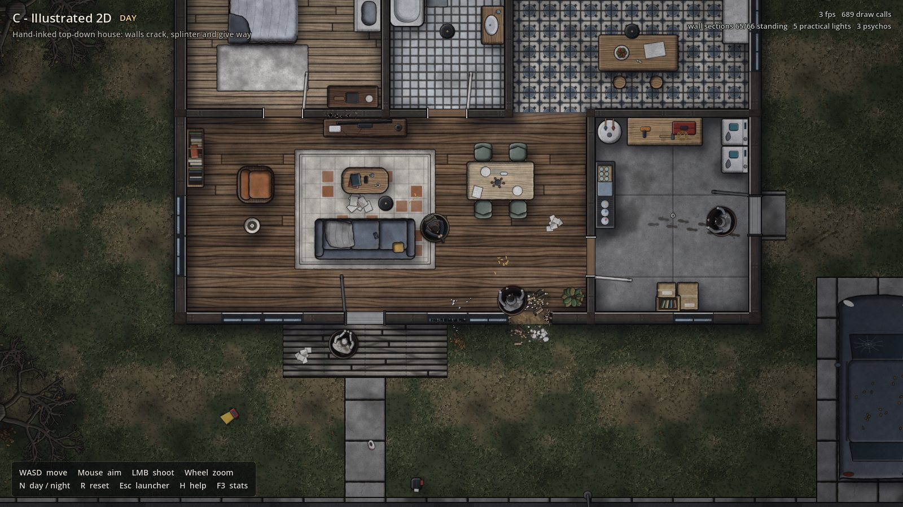 | 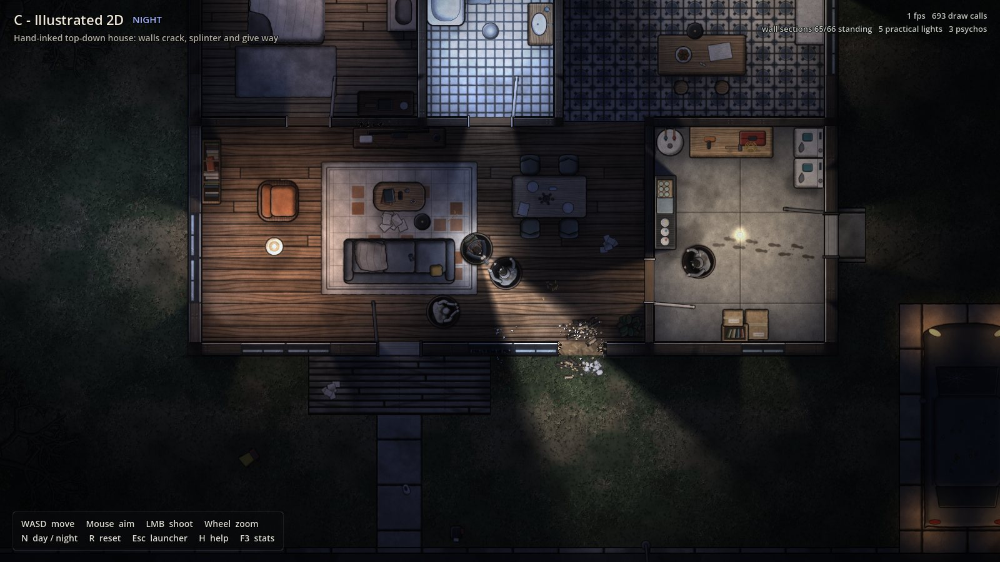 |

Close-ups:

| A | B | C |
|---|---|---|
| 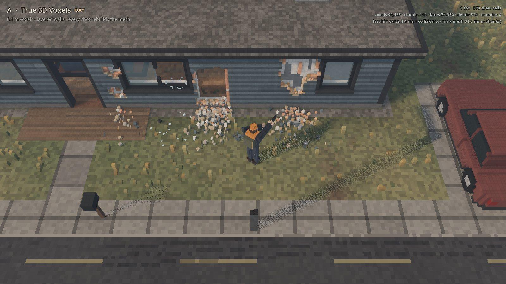 | 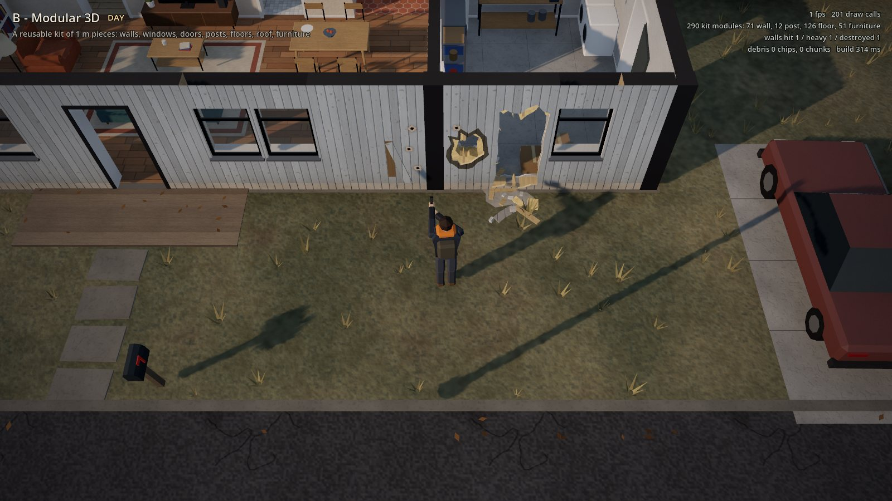 | 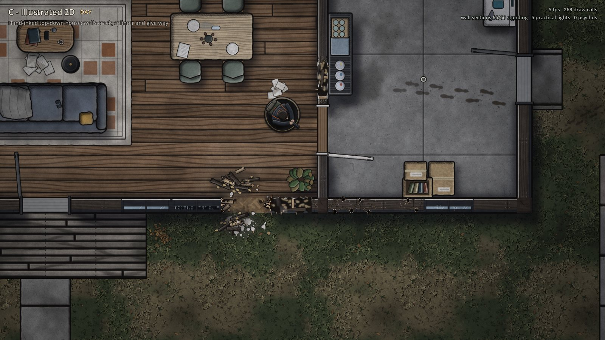 |
| 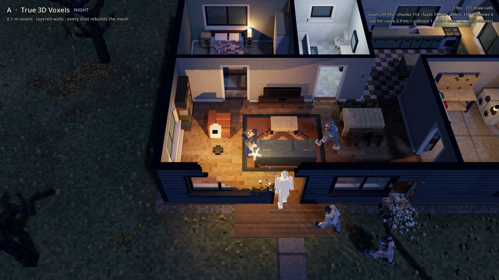 | 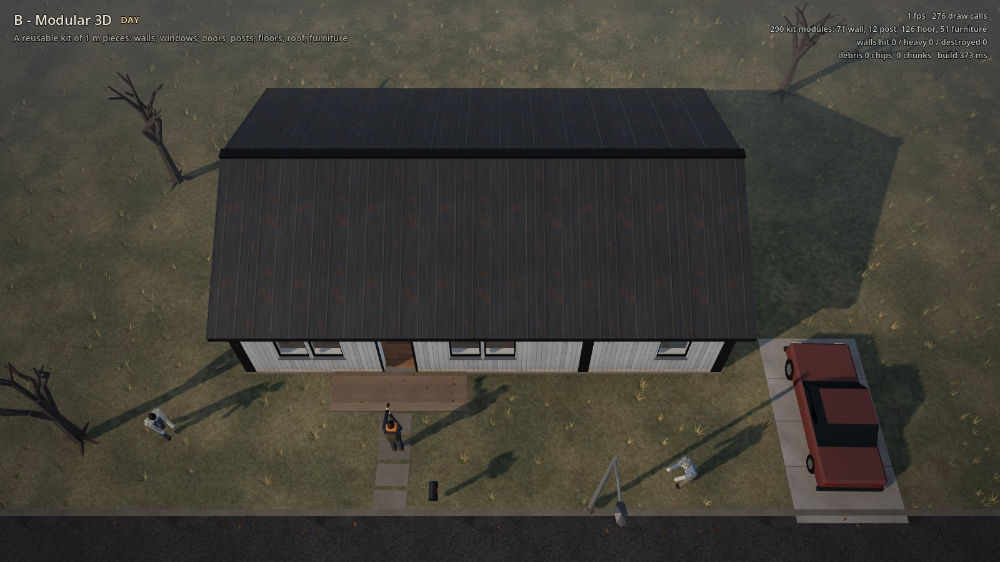 | 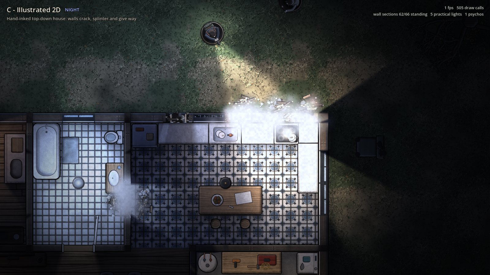 |

Creator overrides. A garish checker PNG placed in the override folder replaces the living-room floor in A and B after a restart (left). C is checked by its own test and screenshot (right).

| A + B | C |
|---|---|
| 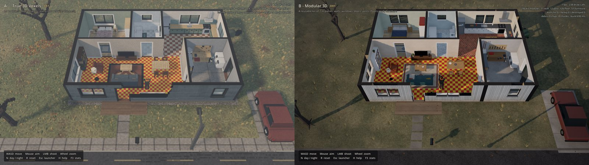 | 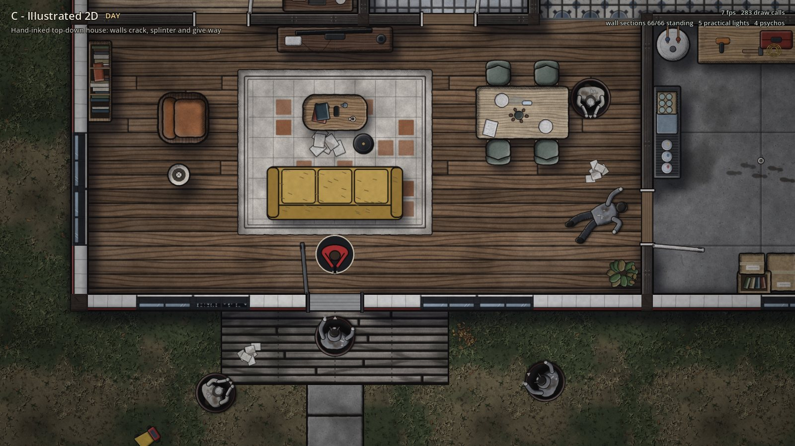 |

## Measured numbers

| | A Voxels | B Modular | C Illustrated |
|---|---|---|---|
| Shots to open a walk-through hole (same pattern) | 12 | 10 | 9 |
| Destruction granularity, visual | 0.1 m voxel; about 0.23 m crater per shot | 1 m module, 4 states (intact → damaged → heavy → destroyed), hole cut where hit | 0.125 m drawn chunks, 1 m sections |
| Destruction granularity, collision and nav | per voxel column / 0.25 m nav cell | 1 m module | 1 m section |
| Draw calls in the comparison scene, day / night | 532 / 1104 | 328 / 814 | 689 / 693 |
| Scene build time (headless) | about 0.7 s (grid 470 ms + meshing about 220 ms) | about 0.1 s (0.3–0.7 s shown under software rendering) | about 0.14 s |
| CPU per wall hit | carve 2–5 ms + collision about 1 ms + remesh 2–4 ms (spikes to 10–30 ms on the shared VM) | 0.4–1.1 ms when a module changes state | about 0.14 ms per shot; about 3 ms when a section collapses |
| Runtime code (GDScript + shaders) | 4,568 lines / 24 files | 5,425 lines / 24 files | 2,390 lines / 10 files |
| Template art | 16 PNGs, 184 KB (tiny swatches: 1 px = 1 voxel face) | 13 PNGs, 2.4 MB (seamless tiling textures) | 76 PNGs, 5.8 MB (every visible thing is a drawing: about 30 furniture pieces, 12 wall, window and door pieces, 10 floors and grounds, 5 character tokens, debris, props, light shapes) |
| Art generator (Python, throwaway) | 275 lines | 487 lines | 3,139 lines (includes the reused Witchening Tales drawing kit) |
| Version-specific tests | 13 | 7 | 7 |

Shared code is 914 lines (plan, nav grid, enemy brain, spawner, asset resolver, HUD). The full suite has 45 tests, all passing.

## Category comparison

| Category | A: Voxels | B: Modular 3D | C: Illustrated 2D |
|---|---|---|---|
| **Visual appearance** | **[D]** A coherent "diorama" look: layered walls, per-voxel material patterns, baked AO and real shadows. Charming but blocky: furniture is chunky at 0.1 m, and the voxel grain shows mostly where things break. Strongly evokes a familiar voxel genre. | **[D]** The cleanest, most conventional stylized 3D: good materials, the most recognizable furniture, Sims-style cutaway. Polished, but the least distinctive of the three. | **[D]** The most distinctive and atmospheric: ink-and-wash drawings, hatching and paper grain; rooted in the Witchening Tales style, in a modern setting. Feels the most hand-crafted. From straight above, walls are thin strips, so the house reads as a plan more than as a building. |
| **Player and enemy readability** | **[D]** Good silhouettes (orange beanie, pale hunched psychos), with an x-ray outline through walls. Figures are small (about 60 px) at default zoom. | **[D]** Similar: low-poly figures, clear poses, readable at default zoom. | **[D]** Excellent *position* readability: round tokens with a facing notch. Less character and body language than the 3D figures. At night they get a faint unshaded copy to stay visible. |
| **Lighting potential** | **[D]** Full 3D lighting: soft shadows, SSAO, glow, shadowed practicals. Daylight streams through holes you shoot because the hidden roof still casts its shadow. That's the most striking lighting moment in the experiment. | **[D]** The same 3D toolset: shadowed practicals, a weapon light throwing shadows through breaches, a flickering bathroom light. | **[D]** 2D lights with occluders, very moody at night: room light spills through holes and windows onto the lawn. No height, so no light from above or under furniture. |
| **Wall destruction** | **[D]** The most physical: any shape, real thickness, siding / studs / insulation / drywall visible in section, floor craters, tall furniture carved, rubble settling. Crumble rules are tuned heuristics, not physics. | **[D]** Convincing, with authored damage: jagged holes cut through each skin with studs and insulation, then rubble. Granularity is one 1 m module, so a wall breaks module by module. | **[D]** Readable and fun: bullet holes, cracks and splintered planks per 0.125 m chunk, then a collapse with dust and debris on both sides. It's the least dramatic, because from above you see the top of the wall, not its face. |
| **Potential for moving walls** | **[F]** Rewriting cells is easy; smoothly sliding a wall needs a separate dynamic voxel body. Harder than B and C. | **[F]** The most natural: a module is a node on a 1 m grid; move it, then refresh nav for the old and new spans. | **[F]** Equally natural: a section is a node; move it plus its occluder and refresh nav. |
| **Potential structural integrity** | **[D]** small: floating fragments under 400 voxels fall. **[F]** whole-house support: needs a coarse support graph, since flood-filling 100k voxels per shot is too slow in GDScript. **[U]** how good collapses would look. | **[F]** The easiest: walls, posts, lintels and roof panels already form a small explicit graph (290 modules), and collapse can reuse the destroyed state and rubble. Not implemented: the roof stays up today. | **[F]** The same graph is easy logically, but there is no vertical dimension, so a roof or ceiling collapse has little to show. |
| **Additional floors and basements** | **[F]** The grid is already 3D and floors have thickness, but voxel count, meshing and draw calls scale per storey, and the cutaway needs per-floor slicing. **[U]** cost for 2–3 storeys. | **[F]** The most practical: stack the kit per level, show one floor at a time with the cutaway (a well-known pattern), add stairs modules. | **[F]** Possible as separate floor maps switched at stairs (a common 2D convention); you can't see two floors at once. |
| **House customization potential** | **[D]** Per-room paint, materials, rugs and floor patterns from swatches. **[F]** Freeform voxel building (any shape). **[U]** a player-facing tool that keeps it tidy. | **[D]** Per-room paint via instance uniforms; textures can be replaced. **[F]** Swapping modules (wall → window → door), material tiers (wood → brick), upgrades: this maps 1:1 onto the module model. | **[D]** Any piece can be redrawn and overridden (tested at a different resolution). **[F]** Swapping sections and material variants by art name. |
| **Creating new house layouts** | **[D]** Built entirely from `HousePlan` data. **[F]** A second layout should just work (not tested); each new furniture *type* needs a sculpt function in code. | **[D]** Built entirely from `HousePlan` data. **[F]** A second layout should just work (not tested); furniture is procedural code today, and real furniture would be modelled meshes. | **[D]** Built entirely from `HousePlan` data. **[F]** A second layout should just work (not tested); new furniture = one PNG plus a plan entry. |
| **Hand-created artwork effort** | **Lowest drawing count**: surfaces are tiny swatches. 3D content (furniture, characters) is code here; in production it would need a voxel editor such as MagicaVoxel, whose `.vox` import is **[F]**. | **Highest skill barrier**: textures are drawable 2D tiles, but every module state, furniture piece and character is a 3D model, or code as here. Each damage state per wall type is extra work. | **Highest drawing count, lowest skill barrier**: 76 drawings for one small house. No rotations or animation frames, because tokens and furniture rotate in-engine. Damage needs 3 strip states per wall type. |
| **Doodle Nook compatibility** | **[D]** for surfaces: 1 px = 1 voxel face, so pixel art drops straight in (override verified). **[U]** for 3D objects: building voxel models from 2D drawings (extrusion from views) is untested. | **[D]** for textures (override verified). Models can't come from a drawing app. | **[D]** The best fit: every asset is a flat PNG with a known real-world size and one orientation rule; a creator PNG at another resolution fits automatically (tested). Doodle Nook only needs canvas presets per asset kind. |
| **Performance** | **[D]** Fine for this house on the CPU side, but the heaviest: ms-scale GDScript remeshing per shot and the most draw calls (about 1,100 at night here). **[U]** Real-GPU frame rate. Shotguns or explosions would need threaded or native meshing. | **[D]** The lightest per hit (sub-ms state changes) and the fewest daytime draw calls. Night more than doubles draws (shadowed lights). **[U]** Real-GPU frame rate. | **[D]** Light CPU load; draw calls are flat day and night (shadowed 2D lights). **[U]** Real-GPU frame rate; expected to be the least demanding. |
| **Engineering complexity** | **High.** A custom voxel engine in GDScript: mesher with AO, ray traversal, carving, crumble rules, keeping nav and collision consistent, per-voxel cutaway, plus an enemy-unstick workaround. | **Medium-high here** (the most code, because damage meshes are generated procedurally). With artist-made meshes per state the code would shrink and the art would grow. | **Lowest.** Standard 2D nodes (StaticBody2D, LightOccluder2D, Light2D); the complexity sits in the art pipeline, not the runtime. |
| **Long-term maintenance** | **Riskiest.** Bespoke systems to own and optimize forever; a third-party voxel extension (C++) is an option but was not evaluated **[U]**. | **Moderate.** Mainstream Godot 3D patterns; the burden is the content (models × states × materials). Procedural modules are invisible in the editor today. | **Moderate.** Simple runtime; the burden is keeping hundreds of drawings in one consistent style, plus the baked-shading-on-rotation compromise. |

## Answers to the seven questions

**1. Which approach offers the most visually appealing result for the least custom artwork?**
**A (Voxels)**, measured as appeal per unit of art. It looks finished from 16 tiny swatches (184 KB), because the voxel style forgives procedural, simple shapes: chunky is the look. B looks good from 13 textures too, but its furniture and characters are procedural primitives that a real game would replace with modelled assets. C is, in my opinion, the most *appealing*, but it costs the most drawings (76 for one house).

**2. Which is best suited for buildings that may eventually be extensively rebuilt?**
It depends on what "rebuilt" means:
- **Structured rebuilding** (replace a wall with a window, upgrade wood to brick, move a doorway): **B**. A module already is a "wall piece with HP, material and state", which is the unit a base-building game needs. C's sections are the same model in 2D.
- **Freeform** (carve and build any shape): **A**. That freedom is harder to turn into clear upgrade rules and costs more engineering.

**3. Which will be easiest to extend with structural integrity?**
**B.** Walls, posts, lintels and roof panels are a small explicit graph, and its destroyed and rubble states already exist to show a collapse. C is as easy logically but shows almost nothing (no height). A can do local "floating fragment falls" today (demonstrated), but whole-house support on 100k voxels needs a second, coarse structural model to stay affordable.

**4. Which makes multi-floor houses most practical?**
**B.** Stacking a kit and cutting away upper floors is a proven pattern. A can do it but pays per storey in voxels, meshing and draw calls. C would treat floors as separate maps. All three would need multi-level navigation, because the shared nav grid is one level (see `docs/BACKLOG.md`).

**5. Which has the greatest risk of becoming an expensive engineering project?**
**A.** It already needed custom meshing, carving, crumble heuristics, careful nav/collision sampling and an enemy workaround. Scaling it (more damage per frame, more storeys, bigger maps, structural integrity) points toward threaded or native code, or adopting a third-party voxel engine.

**6. Which best supports a solo developer who enjoys drawing but does not want to produce thousands of individual assets?**
**C.** Every asset is a drawing, with no 3D modelling, no rotations and no animation frames:
- tokens rotate in-engine;
- furniture is drawn once, front-down;
- floors tile;
- walls need three strip states per wall type.

One house took 76 drawings. A game with a few houses and reused furniture is plausibly a few hundred, not thousands. Doodle Nook would only need canvas presets per kind.

There's a caveat: A is a dark horse if the drawing is **pixel art**. Its swatches are tiny, but 3D objects would still need a voxel editor. B is the least drawing-friendly.

**7. What are the most significant limitations discovered during implementation?**
- **Shared navigation granularity.** Nav uses 0.25 m cells and needs a 0.6 m clear passage. Voxel holes open cell by cell, which exposed a weakness in the shared enemy brain: it oscillates in half-open gaps instead of reporting "stuck". A works around it locally; the fix is logged in the backlog.
- **A:** GDScript remeshing costs milliseconds per shot. 0.1 m voxels make furniture chunky, and halving them costs about 8× more. Per-voxel colour rules out greedy meshing, so faces and draw calls stay high. Clean holes needed tuned crumble heuristics.
- **B:** Destruction moves in 1 m steps, so a module is all-or-nothing for collision and nav. The procedurally built kit is invisible in the editor. Real production would need modelled damage states per wall type and material.
- **C:** From strictly above, destruction and the house's height are hard to sell: you see wall tops breaking, not facades. Furniture shading is baked, so it's wrong when a piece is rotated. Windows always leak light.
- **Verification gaps:**
  - no real-GPU performance measurement;
  - no human playtest (feel is unknown);
  - the `custom/` folder next to an exported executable is untested, because nothing was exported.

## What surprised me

- **A:** sunlight entering only through the holes you shoot, and walls showing siding, studs, insulation and paint in cross-section. This is the strongest "oh, so *that's* what we could do" moment.
- **B:** how much the cutaway plus clean materials made the interior feel like a place, and how cheap a module state change is.
- **C:** how much mood the 2D lights give at night, with light spilling through a fresh hole onto the lawn, and how little runtime code it needed.
- **Disappointments:**
  - **A:** furniture blockiness and the draw-call count.
  - **B:** wall damage reads in 1 m steps.
  - **C:** destruction loses drama from straight above.

## My preference (not a decision)

My reasoning, offered only as input:

1. **B and C share the same gameplay model:** walls are about 1 m sections with HP and damage states. The deep systems you listed (upgradeable buildings, different materials, moving walls, structural integrity, invasions) map onto that model. **A** offers a different, freeform model that is the most spectacular and the most expensive.
2. If **drawing is what keeps you excited**, I'd lean **C**. It's the most distinctive look, the best Doodle Nook fit, the lowest engineering risk, and it continues the Witchening Tales style. The price is weaker visual drama for destruction and multi-floor.
3. If **vertical structure** (multiple floors, visible collapses) is central, I'd lean **B**, accepting that 3D modelling becomes part of the job.
4. I'd keep **A** as the high-risk option. It's worth choosing only if freeform destruction is the heart of the game.

The decision is yours. The best test is to play each version for five minutes and notice which one you want to keep shooting at.

## How to try each version

Run `godot --path .` (or open the project in Godot 4.7 and press F5). In the launcher, press **1** for A, **2** for B or **3** for C. Controls are the same everywhere:
- **WASD** move, **mouse** aim, **LMB** (hold) shoot, **wheel** zoom;
- **N** day/night, **R** reset, **Esc** back to the launcher, **H** help, **F3** stats.

Things to try in each version:
1. Hold LMB on one spot of an outside wall until it opens, then walk through.
2. Stand in a room and let the psychos come: they use your hole or bash their own.
3. Press **N** next to a fresh hole and look at the light.
4. Zoom in on the damage.

The per-version notes list specific things to try: `voxel.md`, `modular.md`, `illustrated.md`.
