# Experiment 002 — The First Days: report

The Version A voxel showcase is now the first playable survival prototype of **Sirens Went Quiet**: one fragile wooden house on a lot ringed by fog. The loop is wake → assess needs → scavenge → return → build and prepare → survive the night → sleep → repeat. The three Experiment 001 demos remain under **Visual Experiments**.

**How it was checked.**
- Automated tests run headless. The integrated playtest drives the real game through real input events (keys, mouse motion, clicks on the actual buttons) under Xvfb with the real Godot 4.7.2 renderer. The renderer used software Vulkan (lavapipe), so nothing here says how fast the game runs on a real GPU.
- **No person has played this build, and no sound has been auditioned by ear** (the sounds were only measured).
- No executable was exported.

## The survival loop

| | What you do | What the game does |
|---|---|---|
| **Wake** | New Game from the main menu: a short intro, then Day 1 07:00 beside the bed | One clock (1 game minute per real second by default) drives a gradual day/night with dawn and dusk ramps |
| **Assess** | HUD: clock, health, food, water, energy, rounds; inventory (I) | Hunger, hydration and energy drain; starving or dehydration costs health; exhaustion slows you; death ends the run (the save is deleted) |
| **Scavenge** | Walk to the lot edge; at the fog press **E** | Expedition screen: 4 destinations, gear choice (rounds, tools), 1–2 decision events, a report. Time and needs advance exactly once |
| **Return** | Eat, drink, heal from the inventory | Loot respects storage caps; anything left over is reported as left behind |
| **Build** | **B**: walls (drag), barricades, doors, doorways, crates, rain collectors, repair, metal sheathing, demolish | Voxel walls and objects with HP, navigation and collision updates, costs, the last-exit rule |
| **Night** | Defend: nine bullets to start | Invasions on Day 3, 6, 9… at 22:00, growing each time; psychos bash doors, barricades and walls; stragglers on some other nights; the survivors leave at dawn |
| **Sleep** | The bed: until morning or 2 h | Restores energy, still costs food and water, and is interrupted by an invasion or a straggler, never skipping it |
| **Save** | Autosave at safe moments; Save in the pause menu | One slot plus a backup, written via a verified temp file; the damaged and rebuilt house is restored exactly |

## What was built (by module)

| Module | Owner | Highlights | Docs |
|---|---|---|---|
| Survival state | S | `GameState` (one clock; decay applied exactly once; ordered events; cheats; sleep planning; invasion schedule; idempotent expedition application), `Inventory` (caps, atomic costs), `Items` (13 items, each with a purpose) | `survival.md` |
| Save | S | Header + checksum + zstd payload; tmp → verify → rotate `.bak` → rename; backup fallback; readable errors | `survival.md` |
| House world | V | Structure-only voxel lot grid (0.1 m storage, **0.2 m damage blocks**); design vs current grids; doors, barricades, crates and collectors as objects with HP; region nav recompute; candle and lantern night light (no grid power); persistence as diffs (a heavily edited house saves to about 18 KB) | `world.md`, `VOXEL_RESOLUTION.md` |
| Construction | V | Palette with 9 tools, ghost previews (green/red with a reason), drag wall runs on a 1 m grid, 0.5 m objects with rotation, repair, metal sheathing, demolish with refunds, last-exit rule | `world.md` |
| Props | P | 47 stylized mesh types forked from Experiment 001's modular kit (all furniture, yard props, doors, barricades, crates, collectors, candles, lanterns, bushes, ghosts), one draw call each, cached, sharing the voxel cutaway | `props.md` |
| Fog and expeditions | E | Fog bank (volume + 10 drifting slices, day/night tint); player-only lot walls; edge prompt; 4 destinations; 11 events; deterministic resolver; departure window; requirement gating | `expeditions.md` |
| UI | U | One visual language (`UiTheme`, `UiModal`); main menu with the fog street and siren mast; settings (4 volumes, fullscreen, controls); pause; HUD; inventory; dev menu (F10); sleep; death; intro; Visual Experiments menu | `ui.md` |
| Audio | A | `AssetResolver.get_audio` (OGG/WAV overrides, fallback with a warning), pooled `Sfx` (positional + UI + music), `Ambience` (day/night beds, distant noises from the fog, tension drone), 47 generated template sounds (2.3 MB) | `audio.md` |
| Game loop | G | `SurvivalGame` orchestrator with helpers (invasion director, enemy roster, footsteps, interactions, save composition, UI ownership, input, fades); sleep, expedition, invasion, death, pause and autosave flows; dev and debug APIs; the integrated playtest | `game.md` |

The contracts between modules are in `SPEC.md`. The modules were built in parallel against stubs and integrated by the lead.

### The 0.2 m structural voxel question

True 0.2 m voxel storage would break the 0.3 m layered exterior walls, the alignment with the 0.25 m navigation grid, and the trim detail. The game therefore keeps 0.1 m storage and removes damage in aligned **0.2 m blocks** (`damage_quantum = 2`). Craters are blockier and show the wall layers more legibly. A shot costs the same (6.5–7.1 ms in total on the shared VM), and a walk-through hole still takes 12 shots. Construction placement (1 m segments, 0.5 m objects) stays separate from damage resolution. The Experiment 001 demo keeps its 0.1 m damage. Details and screenshots: `VOXEL_RESOLUTION.md`.

## Tests

`godot --headless --fixed-fps 60 --path . -s res://tests/run_tests.gd` → **241 passed, 0 failed, 0 skipped**. That includes the Experiment 001 demo smoke tests. Since this experiment the runner also fails a test on any GDScript runtime error and on test files that don't compile.

| Area | Tests | Area | Tests |
|---|---:|---|---:|
| survival | 53 | expedition | 24 |
| save | 13 | ui | 20 |
| world | 12 | audio | 24 |
| build | 8 | game | 26 |
| voxel | 13 | common (plan, nav, brain, resolver) | 20 |
| props | 10 | Experiment 001 smoke + demos | 18 |

## Integrated playtest (the 20-step scenario)

`tools/survival_playtest.sh` runs two separate processes through real input events (WASD, E, I, B + number keys, LMB, mouse aim, Esc, F10, clicks on the real buttons):
- **Part 1:** new game through save and quit.
- **Part 2:** a new process continues the save and verifies it against values part 1 wrote to a JSON file.

The debug API is used to read state, and to act only where input can't reasonably reach; every such use is printed as a note.

**Final run (`tools/survival_playtest.sh`): 23 passed, 0 failed, 0 skipped, 2/2 parts completed.** Real renderer, 1600×900, software Vulkan.

| # | The user's step | Result | What happened |
|---|---|---|---|
| 1–2 | Start a new game; wake on Day 1 | PASS | New Game from the main menu; intro (9.5 s); Day 1 07:00 beside the bed; initial save written |
| 3 | Inspect food, water and inventory | PASS | I opened the panel: 3 canned + 2 snacks, 4 water, 9 rounds |
| 4 | Move around the house and yard | PASS | WASD bedroom → living room → front door (opened with E) → yard |
| 5 | Enter the surrounding fog | PASS | At the lot edge: "[E] Leave the property and head into the fog"; E opened the expedition screen |
| 6–7 | Select a scavenging expedition; resolve an event | PASS | Nearby Homes, clicked through gear and confirm; "Dogs" event answered with key 1 (back away, +25 min) |
| 8 | Return with usable resources | PASS | +2 canned food, +2 snacks, +2 water, +3 planks, +7 nails, a backpack; 170 min advanced exactly once; autosave |
| 9 | Eat and drink | PASS | Inventory Use buttons: hunger 71 → 99, hydration 64 → 98 |
| 10 | Build or repair | PASS | B, 2, LMB: a barricade in the front yard; "Barricade up."; 2 planks and 4 nails paid |
| 11 | Advance time into night | PASS | Dev-menu buttons "Night 20:00", ×10, ×1 → 20:59 |
| 12 | Sleep where safe | PASS | Walked to the bed, E, "Sleep until morning": 21:07 → Day 2 06:00, energy 21 → 99, autosave on waking |
| 13 | Trigger and survive an invasion | PASS | Dev-menu "Next invasion": 3 psychos, killed with exactly the 9 starting rounds (mouse aim + LMB), health 100; "They're gone… for now"; autosave |
| 14 | Observe structural damage | PASS* | *These three died before reaching the house, so the damage was made by 10 player shots into the south wall (472 voxels). A separate capture below shows an invasion breaking in by itself. |
| 15 | Repair or rebuild | PASS | B, 7, LMB on the section: "Wall repaired: 472 voxels (4 planks, 8 nails)" → 0 missing |
| 16 | Save the game | PASS | Three fresh shots left 214 missing voxels for part 2; Esc → Save; the save is valid |
| 17 | Exit and restart the application | PASS | Main Menu → part 1 quits; part 2 is a **new process** |
| 18 | Continue the saved game | PASS | Continue from the main menu: Day 2 21:43 |
| 19 | Structural changes, supplies and survival state persist | PASS | Voxel hash identical; 214 missing voxels; the barricade and both doors in the same places; world data hash identical; inventory identical; stats and player position as saved |
| 20 | Cheat controls and audio override fallback | PASS | Invulnerable (health stayed 100 with a psycho in reach for 4.2 s); unlimited resources (5 shots at 0 ammo, ammo stays 0); both switch off; a corrupt `custom/` override falls back to the template handgun sound |

**Where input was helped (printed by the run):**
- the invasion spawn gap was shortened to 3–5 s through the debug API, to keep the run short;
- the unlimited cheat was switched on with its dev-menu button, twice, to have rounds for the wall-damage shots after the invasion used all nine.
Everything else was real keys, mouse motion and clicks on the real buttons.

**Invasion damage (separate capture, same build).** At night, the player stands invulnerable inside, the doors are closed, and nobody shoots. Within 30 game seconds the three psychos broke the front door ("The door gave way!"), bit 830 voxels out of the walls (including through the bathroom wall), and two of them came inside.

**Test tooling note:**
- Under software Vulkan, any HUD change made the engine redraw the whole 3D scene even with the render loop off (about 0.9 s per frame), so the first runs hit their time limits.
- The playtest now hides the HUD between screenshots: 30 times faster, with the same results.
- It doesn't affect the game on a GPU.

## Screenshots

All are from the game camera, under software rendering.

| | |
|---|---|
| 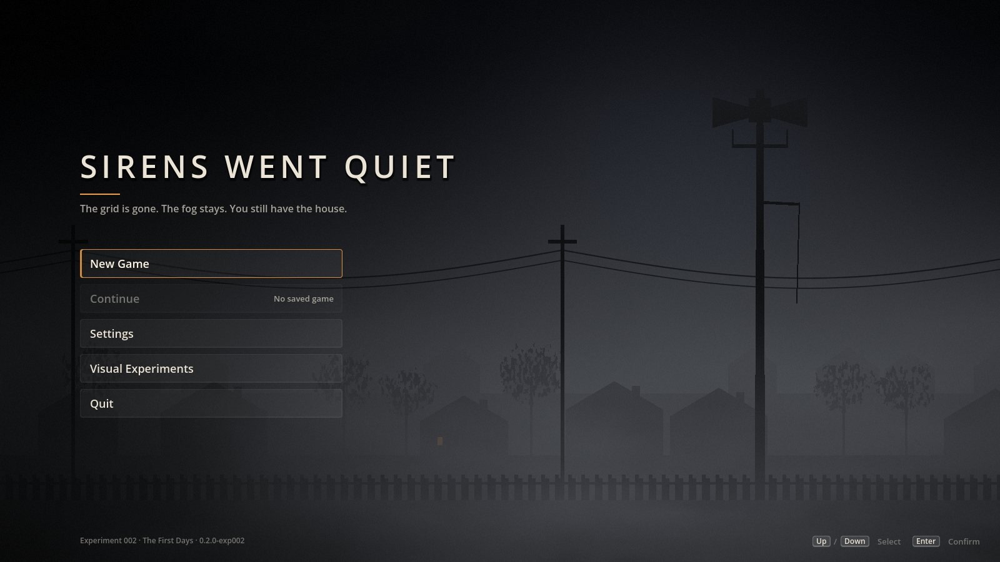 Main menu | 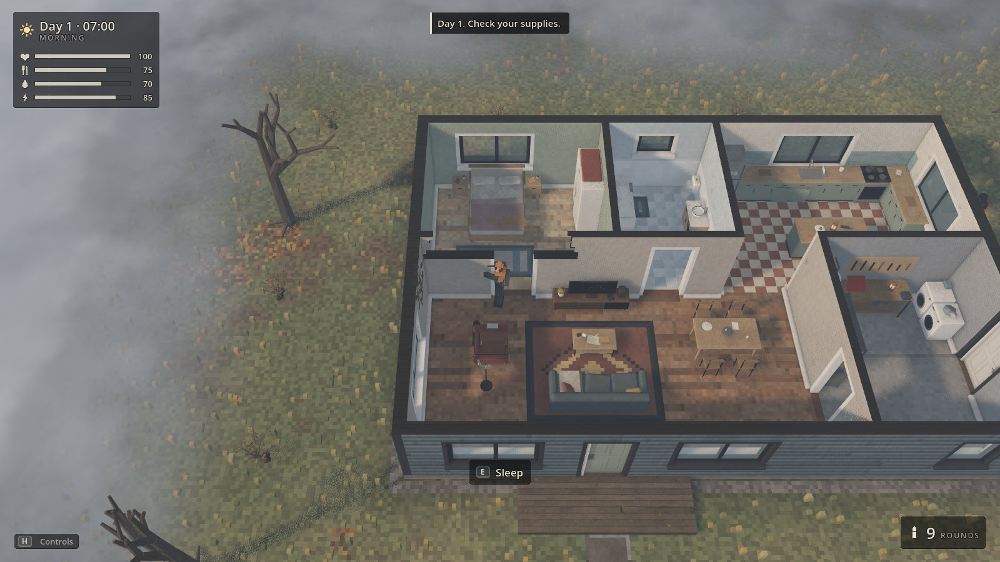 Waking on Day 1 (hybrid house, HUD, bed prompt) |
| 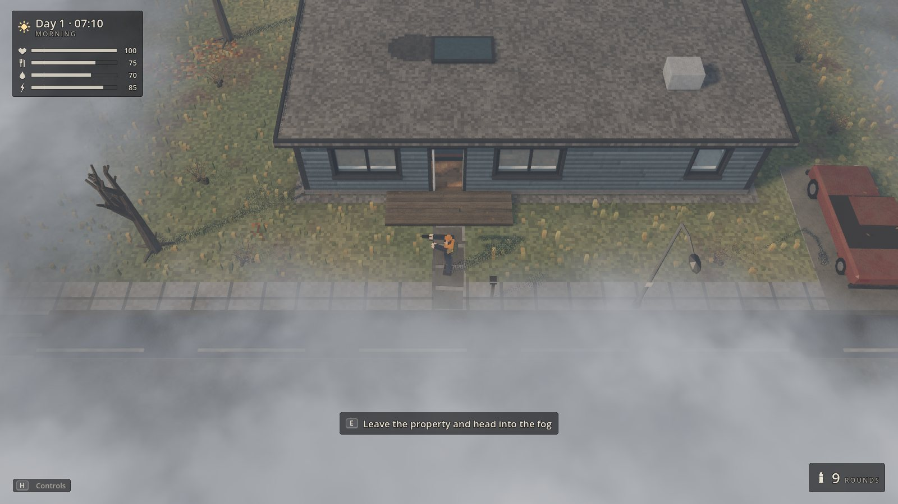 The fog boundary and its prompt | 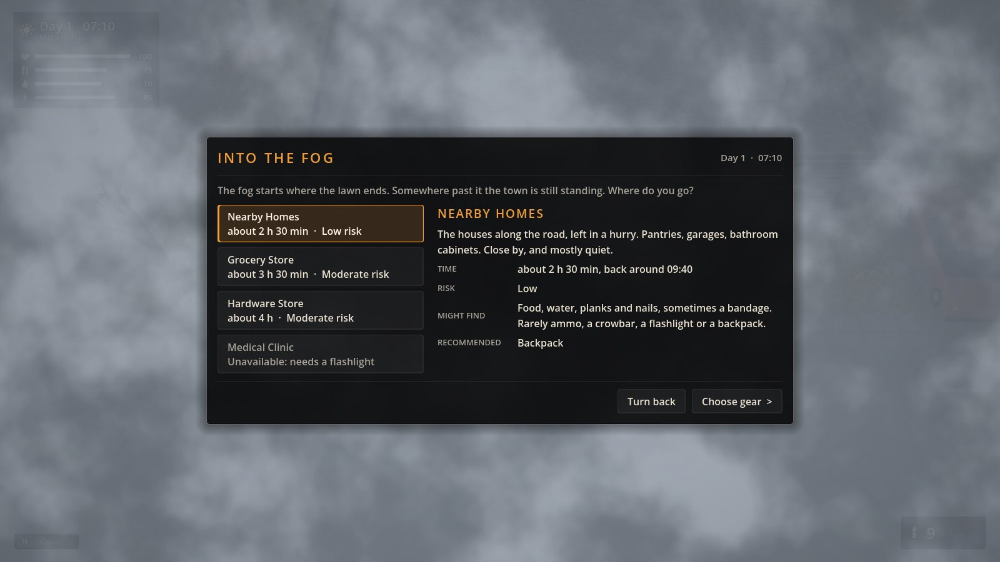 Expedition selection |
| 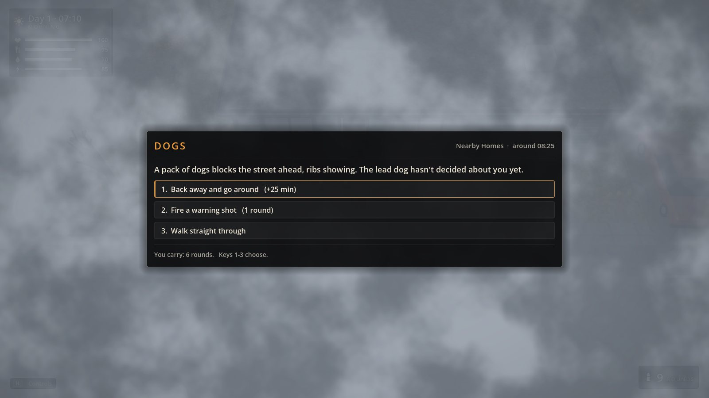 An expedition event | 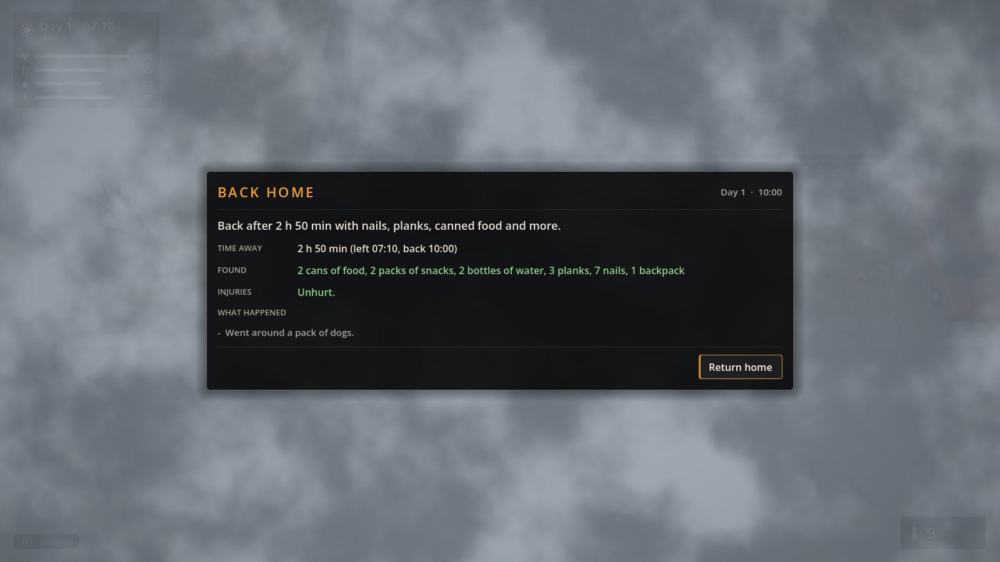 The return report |
| 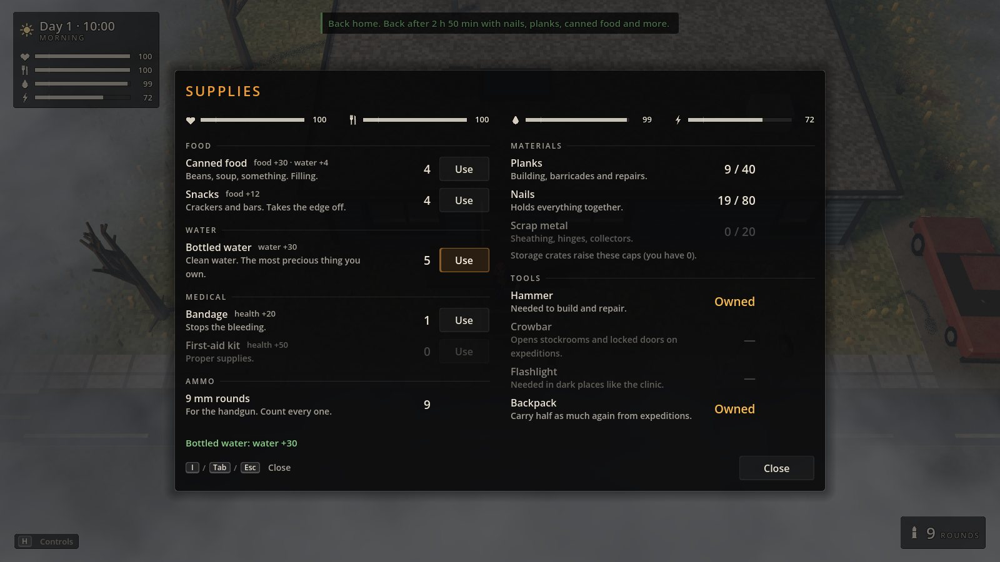 Inventory after eating and drinking | 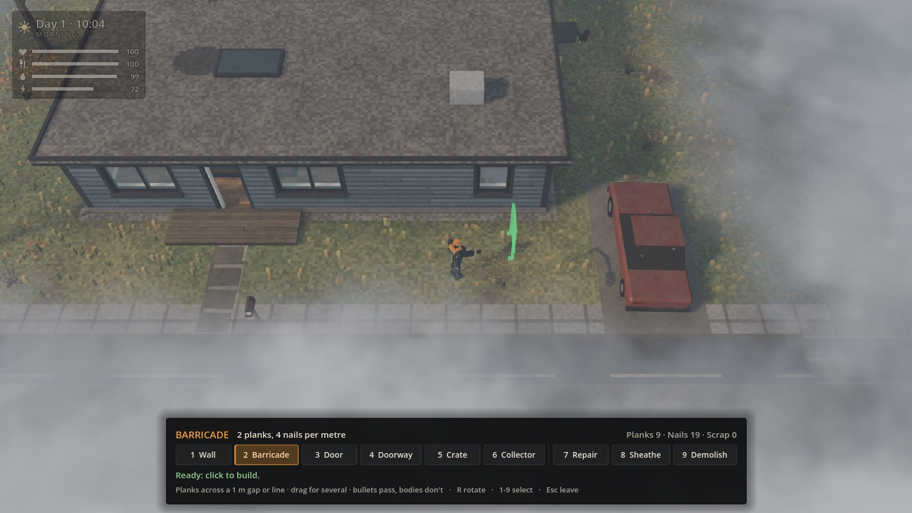 Construction mode (barricade ghost, palette) |
| 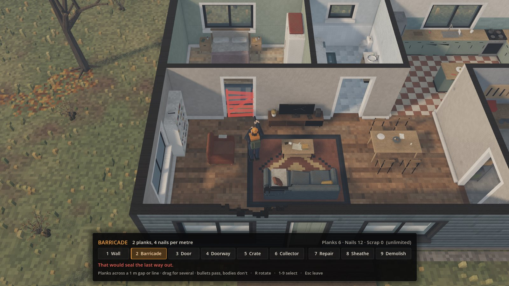 Refused: "That would seal the last way out." | 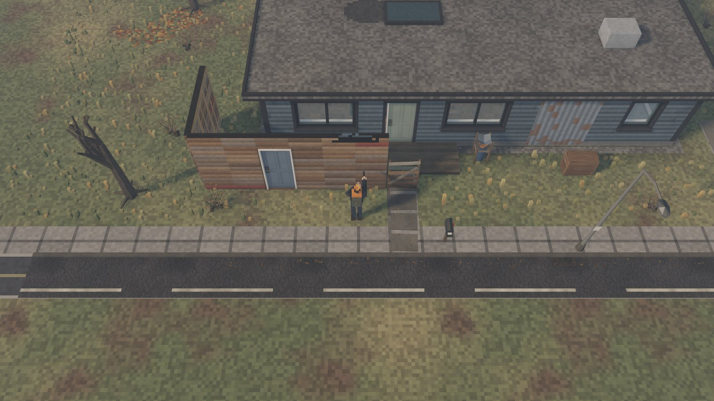 Built wall run, door, barricade, crate, sheathing |
| 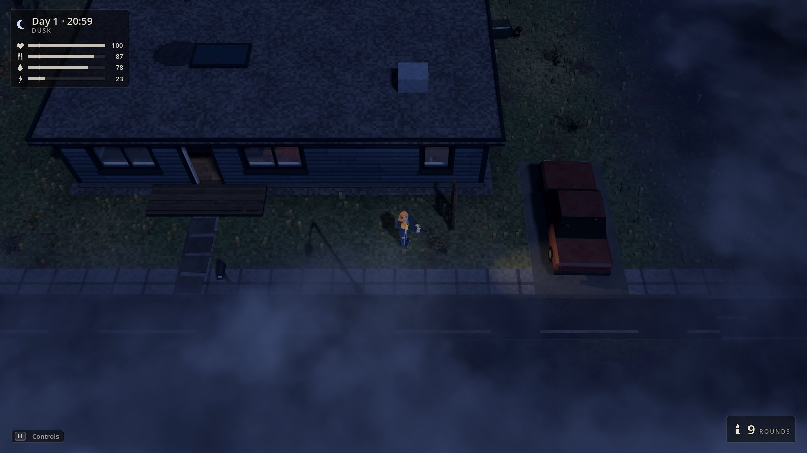 Night in the yard | 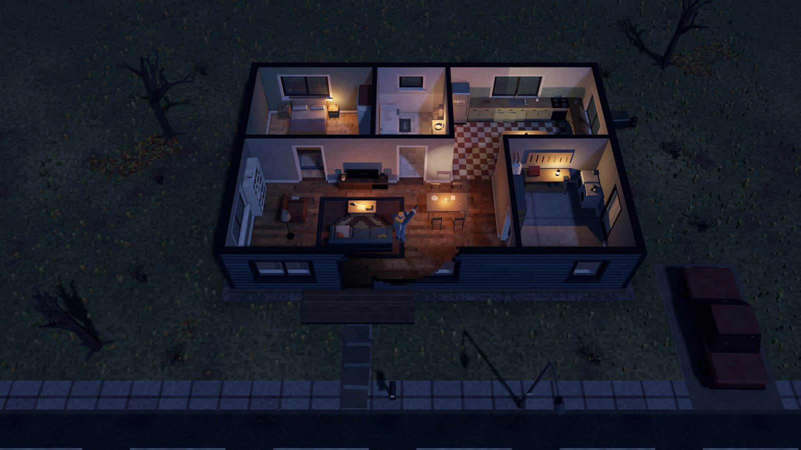 Night inside: candles and lanterns |
| 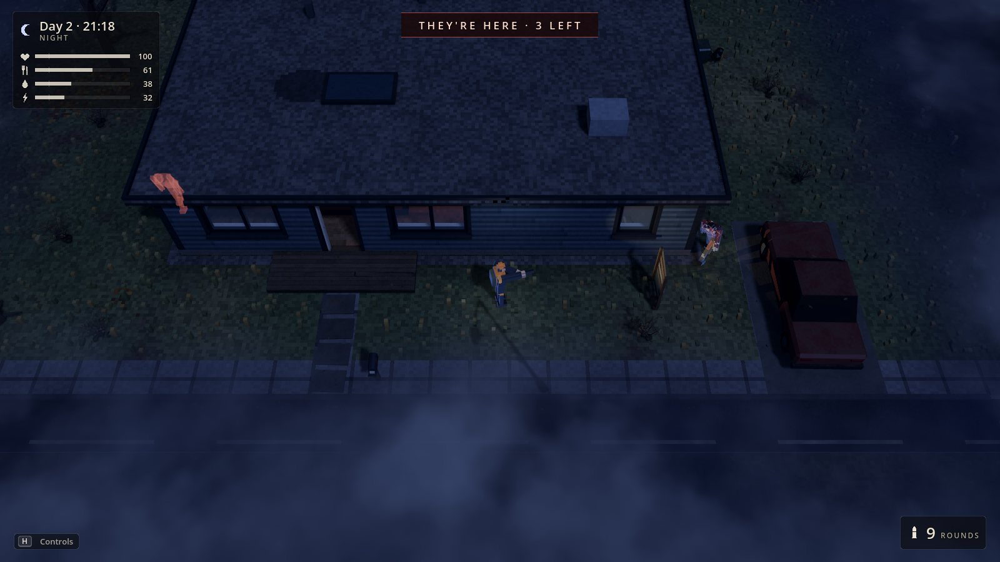 Invasion ("They're here") | 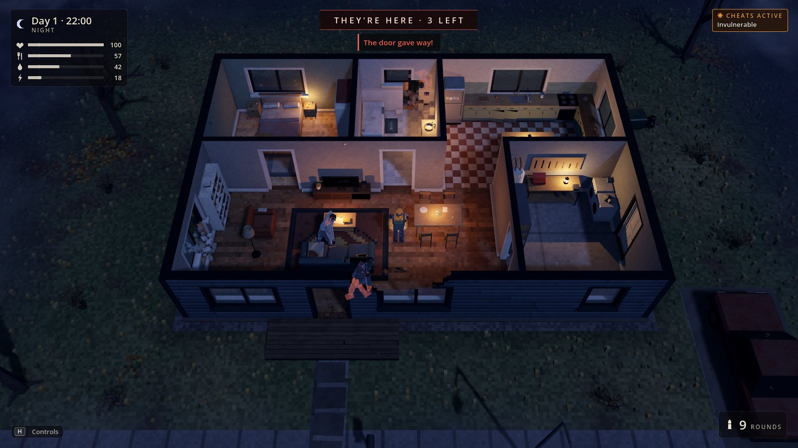 An invasion breaking in: "The door gave way!" |
| 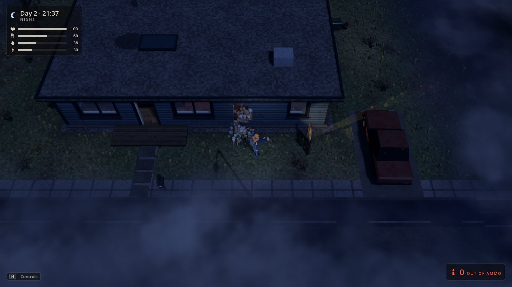 Damaged wall | 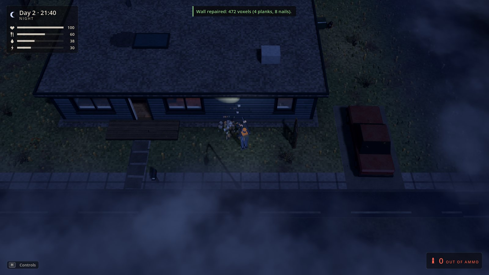 Repaired in build mode |
| 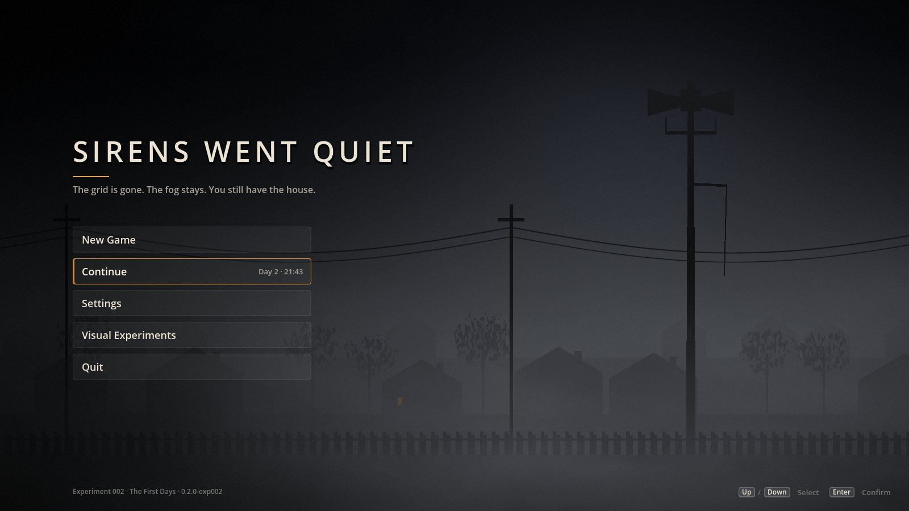 Continue in a new process | 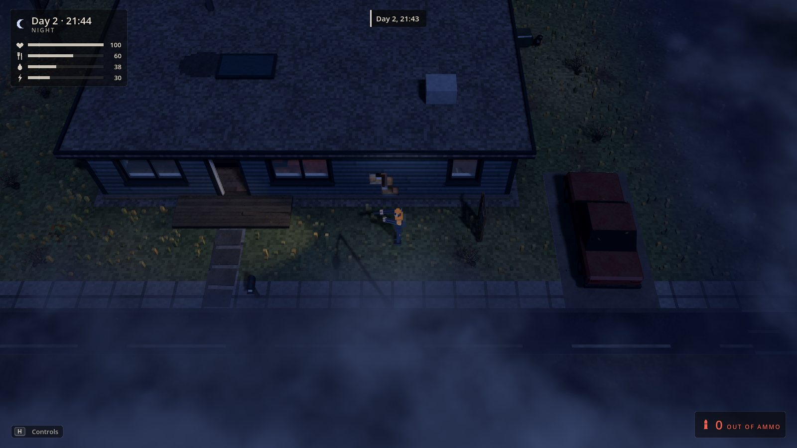 The continued run: same time, holes and barricade |

The house by day and the 0.1 m vs 0.2 m damage comparison are in `world.md` and `VOXEL_RESOLUTION.md`.

## Known limitations

- **Not verified:**
  - human play (feel, balance, difficulty);
  - real-GPU frame rates;
  - listening to the sounds;
  - `custom/` overrides next to an exported game (nothing was exported).
- **Saving:**
  - Live encounters are never saved: you can't save with psychos around, and autosave waits for safe moments. An invasion due later is restored by the clock.
  - One save slot with one backup generation.
- **Combat and pacing:**
  - Invasion spawn gaps are real seconds and ignore the dev time speed.
  - A straggler crossed during a long time skip that ends in daylight never appears.
- **Construction:**
  - An open door leaf has no collision.
  - Two wall runs meeting at a corner leave a 0.1 m notch.
  - Tall props between the camera and the player are hidden whole rather than sliced.
- **Visuals:**
  - Furniture other than the survival pieces doesn't show real damage.
  - The house's light fixtures have no meshes (the grid is down; candles and lanterns light the night).
  - The fog bank is 10 transparent layers plus a volume; its real-GPU cost is unmeasured.
- **Balance:** expedition loot, risk and invasion difficulty are a first pass, tuned from simulations.

The full list of deferred observations is in `docs/BACKLOG.md`.
