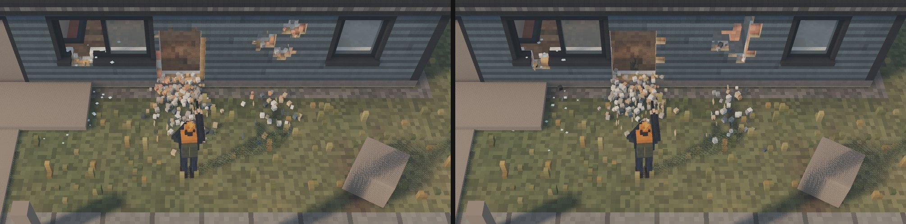

# Voxel resolution: 0.1 m or 0.2 m?

The user asked whether the structure should use 0.2 m voxels. This note records what was compared, the numbers, and the choice. Owner: V. Measurements: `tests/world/test_resolution_study.gd` (headless, shared 4-core VM with six other agents working, so timings are indicative).

## What "0.2 m" could mean

1. **0.2 m storage** (the whole engine at 0.2 m). Not built, on purpose:
   - The exterior walls are 0.3 m with three layers (siding, studs + insulation, drywall) and the interior walls 0.2 m with paint per side. At 0.2 m an exterior wall is one or two voxels, so the layers that make Version A's damage readable disappear.
   - Walls sit on whole-metre plan lines and nav cells are 0.25 m. Voxel centres on 0.1 m multiples line up with both; 0.2 m voxels (centres at 0.1 + 0.2k) can't centre a wall on its line and alias against the 0.25 m nav raster, so collision, the nav rule and door gaps would all need re-deriving.
   - Trim, sills, window frames and mullions, door jambs, siding boards and tile courses are 0.1 m details.
   - Expected gain, by geometry rather than measurement: one eighth of the voxels and about a quarter of the faces (surface area), so cheaper meshing and less memory. Cheaper, but a different, much cruder house.
2. **A 0.2 m damage quantum** inside the 0.1 m storage (implemented): shots and bites remove whole aligned 2 × 2 × 2 blocks. The crater rule is evaluated once per block centre (grown by half a voxel, which keeps the shots needed per hole) with the block's mean hardness. The crumble rules, collision, nav and the mesher are untouched. Intact surfaces keep their 0.1 m paint detail; damage reads at 0.2 m.
3. **A coarser structural presentation** (meshing intact walls as 0.2 m faces while storing 0.1 m) was considered and not built. It would save faces only on intact surfaces, and per-voxel paint is exactly what such a mesher would have to drop.

Construction resolution is a separate thing and stays where SPEC §5 puts it: wall-like pieces on 1 m segments, free-standing objects on 0.5 m cells.

## Measurements

The same house, walls and shot patterns at both quanta: three walk-through holes with Version A's 3 × 4 pattern (bedroom north wall, utility south wall, bedroom west wall), 40 shots spread over a plain stretch of the south wall, and enemy bites on the bedroom's north wall from outside. Experiment 001's demo ran in the same process as a reference.

| | Exp. 001 demo (0.1 m) | 0.1 m damage | 0.2 m damage |
|---|---|---|---|
| Shots to open a walk-through hole (3 walls) | 12 / 12 / 12 (`test_voxel_scene`) | 12 / 12 / 12 | 12 / 12 / 12 |
| Voxels removed by those 36 shots | — | 1,492 | 1,764 |
| Faces after the 3 holes (house starts at 64,874) | — | −328 | −468 |
| Faces after 40 spread shots | — | −400 (64,474) | −480 (64,394) |
| Enemy bites to open the bedroom wall | — | 24 | 21 |
| Carve + crumble per shot | 4.2 ms avg, 6.2 max | 4.4 ms avg, 8.3 max | 5.4 ms avg, 12.2 max |
| Collision rebuild per shot | 1.5 ms | 1.7 ms | 1.7 ms |
| Whole shot (rays, carve, collision, nav, fx) | — | 6.5 ms avg, 9.8 max | 6.8 ms avg, 13.6 max |
| Mesh rebuild per shot | 4.3 ms avg, 10.3 max | 4.7 ms avg, 11.9 max | 4.5 ms avg, 11.6 max |

Face counts fall after shooting because holes remove wall surface faster than the crater edges add it; coarser craters have fewer edges. Carve + crumble came out about 1 ms slower at 0.2 m in both final runs (5.3–5.4 ms against 4.4–4.7 ms): it removes about 18 % more voxels per shot and tests blocks first. The whole shot and the mesh rebuild came out the same within the VM's noise. So **the quantum is not a performance lever** in either direction; true 0.2 m storage would be one, at the cost listed above.

The first 0.2 m version, without the half-voxel growth, needed 12 / 19 / 12 shots: block centres sit 0.1 m apart, so the same radius caught fewer blocks on some alignments. Growing the threshold by half a voxel per step brought it back to 12 / 12 / 12 with about 18 % more voxels per shot.

## Visual clarity (same camera)

Same scenario and camera (`world_preview.tscn --scenario=res --quantum=1|2`, 11 m zoom, the closest the game camera allows): a walk-through hole, two craters and a shattered window, 0.1 m on the left, 0.2 m on the right.

- **0.1 m:** finer, rounder craters. The layers show as thin rings; small hits read as scattered single-voxel chips, a little noisy at this zoom.
- **0.2 m:** chunkier, blockier craters with clean steps. The siding, the pink insulation and the studs show as distinct blocks, and the hole edge reads as a deliberate shape from the game camera. Wall chips are drawn 1.45× larger to match.

At the default 20 m zoom a 0.1 m voxel is only a few pixels, so the 0.2 m blocks are the more legible of the two.

## Decision

- **Game:** `HouseWorld.damage_quantum = 2`, 0.2 m damage blocks in 0.1 m storage. Damage looks like 0.2 m voxels, as the user asked, while the intact house keeps its 0.1 m detail and every system (collision, nav, crumble, persistence, construction) stays the same. Costs and shots per hole match 0.1 m.
- **Version A demo:** unchanged at 0.1 m (`VoxelCarver.carve_sphere(..., quantum := 1)` by default).
- **Baseline kept:** set `damage_quantum = 1` (or `--quantum=1` in the preview scene) to get Experiment 001's damage back.
- **Not done:** true 0.2 m storage, for the reasons above. Worth revisiting only if a much larger map or many simultaneous carves (explosions) make meshing the bottleneck, and then together with threaded or native meshing.
