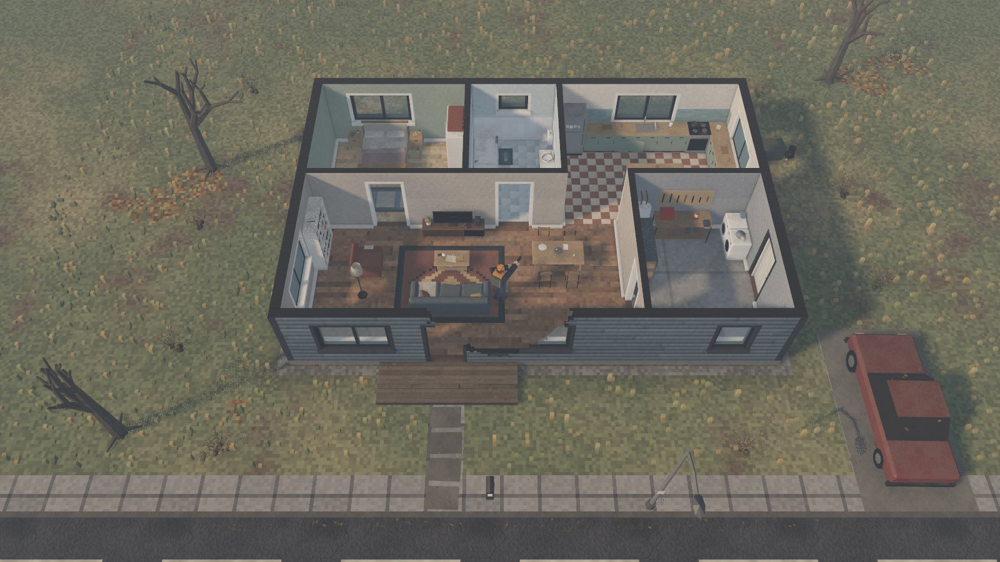
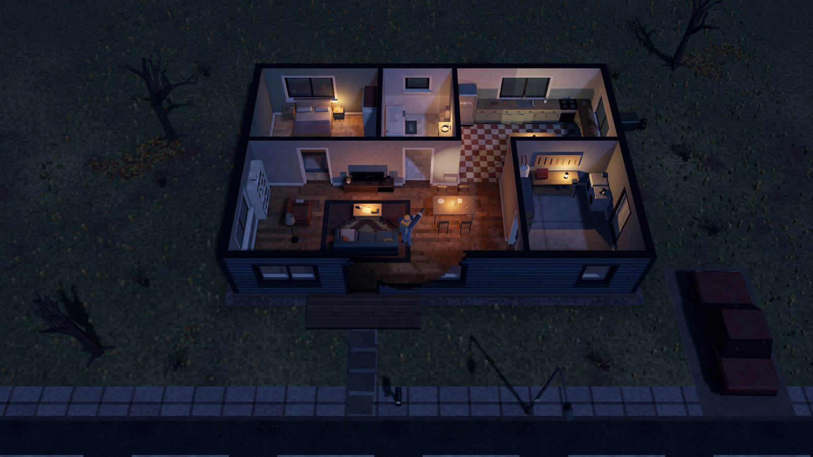
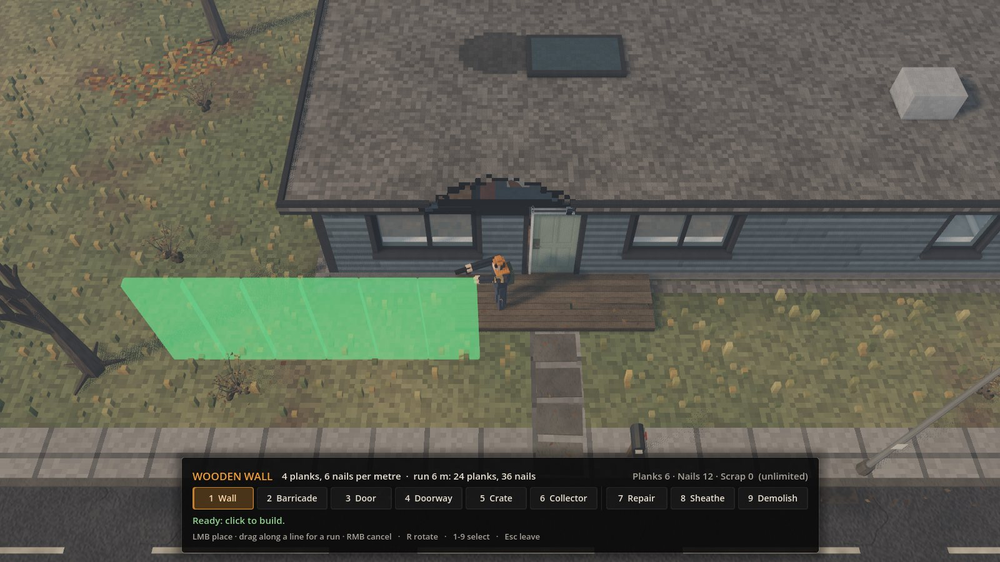
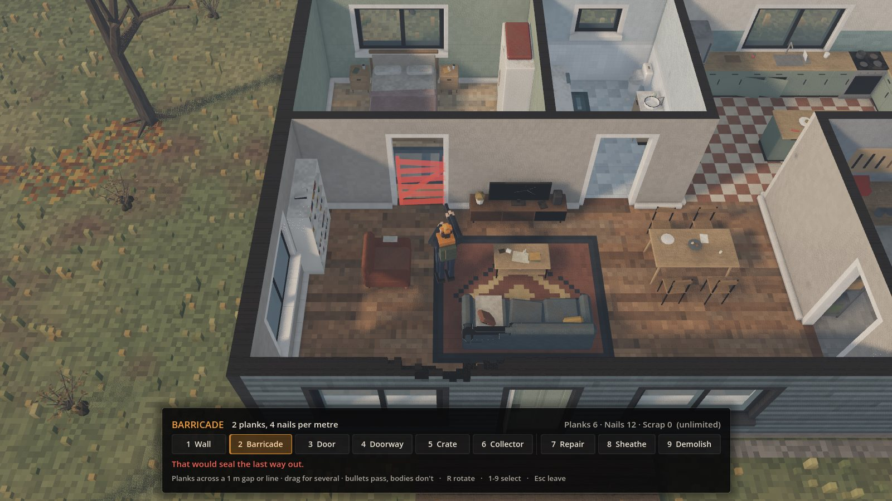
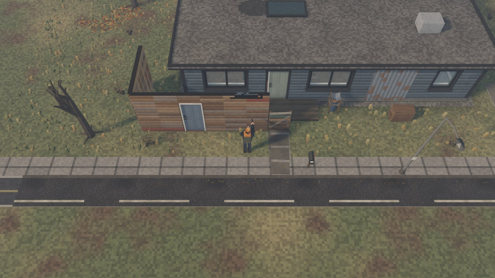
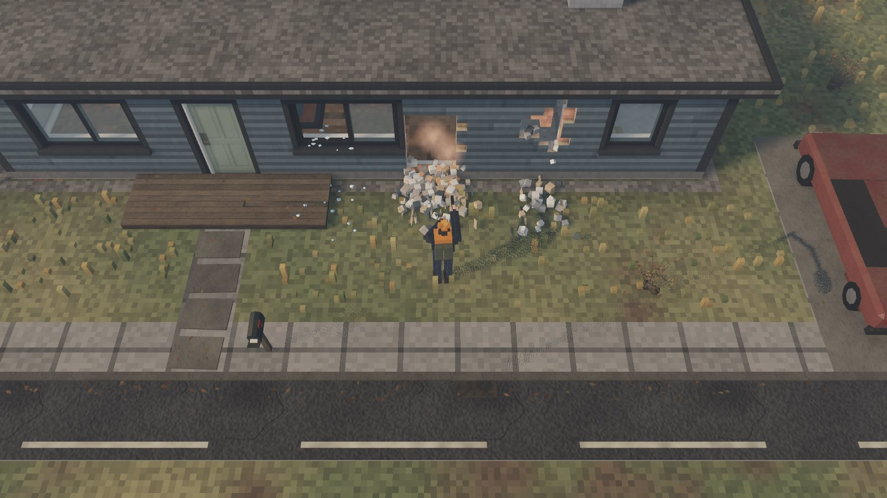
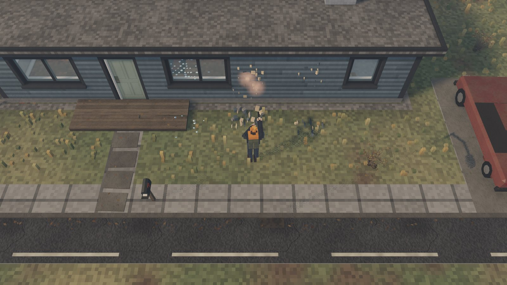

# World and construction (Experiment 002)

Owner: V. Code: `src/world/` (house, objects, preview scenarios), `src/build/` (build mode), shared voxel engine in `src/voxel/`. Tests: `tests/world/`, `tests/build/`. Contracts: SPEC §4–§7.4.

The survival house is Version A's voxel engine with a hybrid look: **structure is voxels** (foundation, floors, walls, trim, windows, rugs, roof), and **everything else is a conventional mesh** from `PropKit` (furniture, doors, barricades, crates, rain collectors, candles, lanterns, yard props, bushes). The Version A demo (`res://src/voxel/voxel_demo.tscn`) is unchanged: every new behaviour sits behind options whose defaults are Experiment 001's.

## The house world (`HouseWorld`, `src/world/house_world.gd`)

- **Lot-sized grid.** The voxel grid now covers the whole lot (SPEC §5 LOT) so walls can be built anywhere on it: 232 × 31 × 162 cells of 0.1 m (`VoxelHouse.create_grid(true)`), on the same lattice as before, so the house builds voxel-for-voxel the same. The structure-only house has 83,531 voxels and 64,874 faces in 122 non-empty chunks (the Version A house with voxel furniture: 100,514 voxels, 75,044 faces).
- **Options** (set before `build_new()` / `load_data()`): `voxel_furniture` (false: meshes; true: Version A's voxel furniture and voxel yard props) and `damage_quantum` (2 = 0.2 m damage blocks, the game default; 1 = Version A's 0.1 m; see `VOXEL_RESOLUTION.md`).
- **Design and current.** `design` is the intended structure (pristine house + construction − demolition); `grid` is the current state (design − damage). Shots and bites change only `grid`. Building, cutting, sheathing and demolishing change both. Repair copies `design` back over `grid`.
- **Furniture and props.** One `PropKit` mesh per `HousePlan.FURNITURE` and `HousePlan.PROPS` entry (rugs stay voxel), centred on its plan rect, turned to its facing by a wrapper node (the kit is asked for facing "N", so a kit that rotates by `facing` itself still ends up right). Size is `Vector3(width across the front, height, depth)`. Blocking pieces get a box: **tall** ones (≥ `Tuning.TALL_THRESHOLD`) on layer 1 with an `impact` meta (they stop bullets: impact fx, no damage), **low** ones on layer 5. Ten bushes dress the lot edges (visual only).
- **No grid power.** `VoxelLighting.set_practicals_enabled(false)` keeps the house fixtures dark. Night light comes from six candles and battery lanterns on furniture (PropKit `candle` / `lantern`, emissive parts driven through the `lit` instance parameter) with warm, slightly flickering `OmniLight3D`s; only three cast shadows (kitchen island lantern, coffee-table candle, utility lantern). The weapon light, moonlight and fog glow do the rest. They follow `lighting.night_amount`.
- **Cutaway.** The voxel cutaway is unchanged. Tall meshes (tall furniture, trees, the car, doors, barricades, collectors) whose centre lies in the cut cylinder between the camera and the player are switched to shadows-only (they vanish but keep their shadow) and `aim_ray` ignores their bodies.

### Objects (`WorldObject`, `src/world/world_object.gd`)

| Kind | HP | Footprint | Collision (SPEC §4) | Navigation | Interaction |
|---|---|---|---|---|---|
| `door` | 18 | 1 m wall segment | closed: layers 1+2 (blocks bodies, stops bullets with a wood impact, no damage); open: none | closed WALL (psychos path to it and bash it), open OPEN | E opens/closes; swings the kit's `Leaf` child 95° to the inside (side picked from the leaf's geometry). Refuses to close on a body. |
| `barricade` | 12 | 1 m segment | layer 2 (bodies blocked, bullets pass between the planks) | WALL | — |
| `crate` | 10 | 1.0 × 0.5 m, 0.5 m cells, R rotates | layer 1 | SOLID | prompt shows the capacity bonus (+20 planks, +40 nails, +10 scrap) |
| `rain_collector` | 10 | 0.5 × 0.5 m | layer 1 | SOLID | prompt: "1 water at dawn" |

A run starts with closed wooden doors in the front and back doorways. An enemy swing (`enemy_strike`) at a nav cell occupied by a closed door or a barricade costs it 1 HP (`Tuning.ENEMY_WALL_DAMAGE`); its visual is rebuilt with `damage` = lost fraction. At 0 HP it breaks into wood debris, `object_destroyed(kind, at)` is emitted and nav and collision open. Measured: one psycho walks to the closed front door, bashes it down in 19 s (18 swings) and comes in a second later, without biting the wall. The bed stays `bed_interactable.gd`; `bed_position()` is the foot of the bed (where the player stands and where the exit rule starts).

### Navigation

`GridNav` raw cells are recomputed per region, never one-way: a cell is **SOLID** for blocking furniture, yard props, crates and collectors; **WALL** for closed doors, barricades and any structural voxel in its footprint columns (0.25 m) between the nav rows (0.15–1.6 m); otherwise **OPEN**. In a door-like gap (the plan's doorways and every cut opening) only voxels inside the gap count, so the jambs don't narrow it: on the intact house with the doors open the result equals `HousePlan.rasterize_into` cell for cell (tested). Damage rechecks only WALL cells in the change's area (it can only open); construction recomputes its area fully, so a built or repaired wall closes nav again.

### The exit rule

`exit_path_exists(extra := {})`: a 4-connected search over walkable cells (body clearance) from the foot of the bed to any cell outside the LOT. Doors count as passable, open or closed; walls, barricades, furniture and objects block. `extra` previews a change (nav cell → kind) without applying it. About 2 ms when a way out exists.

### Sections (structure for a later support model)

`sections` holds every 1 m wall section along integer plan lines, `Vector3i(axis, line, start)` (axis 0: along x on y = line; 1: along y on x = line), with its structural voxel count in the design and in the current grid. Every shot keeps `current` up to date from the carve's removed cells (no voxel scans); construction recounts the sections it touches. `section_integrity(seg)` (0..1) and `section_info(seg)` read them. Nothing uses integrity yet: a coarse structural-support model can be added later on top of this registry. Structural integrity is not implemented (out of scope).

## Construction (`BuildMode`, `src/build/`)

**B** toggles build mode (the game calls `set_active`); it needs a hammer unless the unlimited cheat is on. While active, `handles_input()` is true and the game doesn't fire. A compact bottom bar in `UiTheme` style shows the slots, the selected piece and its cost, owned materials, a status line (green when the preview is valid, red with the reason) and a hint.

| Key | Piece / tool | Cost (SPEC §6) | Notes |
|---|---|---|---|
| 1 | Wooden wall | 4 planks + 6 nails per metre | 1 m segments on integer plan lines, click-drag along one axis for a run (up to 12 m). 0.2 m thick (two voxels on the line, like interior walls), full height: outer boards in mismatched scavenged tones, inner boards with studs every 0.5 m, a sole plate where it stands on the ground. The outer side is the one away from the bed. |
| 2 | Barricade | 2 planks + 4 nails per metre | object; runs too |
| 3 | Door | 4 planks + 6 nails + 1 scrap | cuts a 1 m wall segment (2.1 m, header stays) or fills an existing 1 m gap, and hangs a closed door facing out |
| 4 | Doorway | free | cuts a 1 m opening, 2.1 m high |
| 5 | Storage crate | 3 planks + 4 nails | 0.5 m cells, R rotates |
| 6 | Rain collector | 2 planks + 2 nails + 3 scrap | 0.5 m cells, R rotates |
| 7 | Repair | 1 plank per 150 missing voxels + 1 nail per 60 (rounded up); objects: lost-HP fraction × the piece's cost, at least 1 plank | aim at a damaged 1 m section (restores the design over the section plus 0.1 m past each end: windows get their glass back, sheathing comes back as metal) or at an object |
| 8 | Metal sheathing (upgrade) | 3 scrap + 4 nails per section | the outermost structural voxel of every column and row of the section becomes `VoxelMat.METAL_SHEET` (hardness 0.92, corrugated grey with rust). A shot that hits sheet metal carves at 0.45 × the radius: in the test three shots removed 32 voxels from a sheathed wall and 172 from a plain one. Not on windows. |
| 9 | Demolish | free | player-built walls and objects refund half the cost (rounded down; nothing under the unlimited cheat); an original wall section becomes a full-height opening; original doors come down without a refund |

**Controls:** LMB places or applies (press–drag–release for runs), RMB (`secondary`) cancels a drag, R (`build_rotate`) rotates, number keys select, Esc is the game's (it calls `set_active(false)`). Walls, barricades, crates and collectors follow the ground point under the mouse; doors, doorways and the tools follow the aimed surface (`aim_ray`, so the cutaway works).

**Validity and refusal reasons** (the ghost turns red, the status line shows the reason, a click emits it through `message`): "Outside the lot: the fog starts there." · "There's already a wall here." · "There's a window here." · "Furniture is in the way." · "Something is already standing here." · "Someone is standing there." (player or enemy, via a physics query) · "There's a wall in the way." · "A door needs a wall or a 1 m doorway." · "Not in a window." · "Windows can't be sheathed." · "Already sheathed." · "This wall is intact." · "Nothing to demolish here." · "Needs 4 planks, 6 nails." · "You need a hammer." · **"That would seal the last way out."** (the exit rule, checked for walls, barricades, crates and collectors).

**Sounds** (`Sfx`, SPEC §7.6): `build/place`, `build/hammer`, `build/invalid`, `build/upgrade`, `build/demolish`, `door/open`, `door/close`, `door/bash`, `structure/break` (object destroyed), `structure/crumble` (a wall gives way), and `impact/*` for shots.

Construction resolution (1 m wall segments, 0.5 m object cells) is separate from damage resolution (0.2 m blocks in 0.1 m storage).

## Persistence

`save_data()` returns a versioned dictionary (Variant-safe, for `store_var`):

```
{"version": 1, "layout": "swq-house-1|(232, 31, 162)|mesh-furniture", "cells": 1165104,
 "design":  VoxelDiff vs the pristine house,
 "current": VoxelDiff vs the pristine house,
 "objects": [{"kind", "x", "y", "rot", "hp", "open", "built"}],
 "built": [[axis, line, start]], "upgraded": [[axis, line, start]], "openings": [[axis, line, from, to]]}
```

A `VoxelDiff` (`src/voxel/voxel_diff.gd`) lists removed cells and added or changed cells with `mat`, `col`, `pcol` and `pmask`; index lists are ascending and delta-encoded, and every array is zstd-compressed. `load_data(d)` validates everything before building anything (version, layout, grid size, array sizes, strictly ascending in-range indices, never the empty border, solid materials, object kinds, finite positions inside the yard, HP within range, segment tuples) and returns false without crashing or building on any mismatch; the caller can then call `build_new()`. A loaded house is identical to the saved one: the test compares both grids array by array, every nav raw cell, the objects, sections and damage summary.

Measured on the shared VM (test `test_persistence_round_trip_restores_the_exact_house`: a shot-open hole, three more shots, 4 m of built wall, a barricade, a crate, a collector, a sheathed section, a cut doorway, a damaged and an open door): **18.2 KB** after `var_to_bytes`; `save_data` + serialisation **83–103 ms**; `load_data` **0.68–0.78 s**, most of it meshing and collision for every chunk plus a full nav pass. A fresh house saves in about 1 KB.

## Performance

Measured headless on the shared 4-core VM while other agents ran; the same run measured Experiment 001's demo for reference (`tests/world/test_resolution_study.gd`).

| | Exp. 001 demo | Game, 0.1 m damage | Game, 0.2 m damage (default) |
|---|---|---|---|
| Carve + crumble per shot | 4.2 ms avg, 6.2 max | 4.4 ms avg, 8.3 max | 5.4 ms avg, 12.2 max |
| Collision rebuild per shot | 1.5 ms | 1.7 ms | 1.7 ms |
| Mesh rebuild per shot | 4.3 ms avg, 10.3 max | 4.7 ms avg, 11.9 max | 4.5 ms avg, 11.6 max |

A whole shot (ray casts, carve, collision, nav recheck, section counters, fx) costs 6.5–6.8 ms on average. Startup: the structure-only pristine grid takes about 0.4 s once per run, then `build_new` about 0.48 s (meshing and collision for 330 chunks, a 70 ms nav pass). A 12 m wall run costs about 90 ms on the click (voxels into both grids, collision, nav, 12 ms of meshing; the rest meshes over the next frames). `repair_all` (dev) about 0.19 s. No stability is computed per shot.

## Review scenes and screenshots

`res://src/world/world_preview.tscn` arranges the real world for screenshots (no extra gameplay): `--scenario=house | build | build_bad | built | damaged | repaired | res`, plus `--night` and `--quantum=1|2`.

```bash
CAPTURE_ENGINE_ARGS="--fixed-fps 10" LP_NUM_THREADS=1 tools/capture.sh res://src/world/world_preview.tscn /abs/out.png 2 --scenario=built
```

| | |
|---|---|
|  House by day (voxel structure, mesh furniture) |  Night: candles and lanterns, no grid power |
|  A 6 m wall run, valid |  A barricade that would seal the bedroom |
|  Built wall with a door, a barricade on the path, crate, collector, sheathed south wall |  /  Shot-up wall, then repaired (glass back) |

## Tests

`godot --headless --fixed-fps 60 --path . -s res://tests/run_tests.gd -- --filter=world` (and `--filter=build_mode`):

- `tests/world/test_house_world.gd`: plan raster equality and starting doors; doors in nav and collision; enemy strikes damaging and destroying doors and barricades; nav recompute (a shot hole opens, repair closes, a built wall closes, demolish reopens); the exit rule; the persistence round trip; refusal of other versions and damaged data; furniture meshes, collision layers and mesh cutaway; no-power night lights; a psycho bashing through a closed door.
- `tests/world/test_resolution_study.gd`: the numbers in `VOXEL_RESOLUTION.md`.
- `tests/build/test_build_mode.gd`: validity and refusal reasons, the exit-rule refusal, costs and the unlimited cheat, repair restoring voxels and charging the cost, sheathing (fewer voxels per shot), demolish refunds, doors and doorways, the hammer requirement.

## Limitations and known issues

- **PropKit is still the placeholder** in this branch: furniture, doors, barricades, lights, the road and the path render as plain boxes until agent P's meshes arrive. The road, path and driveway props sit on top of the voxel ground texture that already paints them.
- **One storey.** No multi-floor building; no structural integrity (sections only count voxels).
- **Built walls are 0.2 m.** They stand on integer plan lines like interior walls; two runs meeting at a corner leave a 0.1 m notch at the outer corner (it never lets a body through).
- **1 m openings are tight for navigation:** a 1 m gap has two walkable nav columns (body clearance), as the plan's doorways always had.
- **Cutaway of meshes is all-or-nothing** per prop (no partial slicing like the voxels).
- **Open door leaves** have no collision.
- **`repair_all`** (dev) re-meshes and re-collides every chunk (about 0.2 s plus a few frames of meshing).
- Not human-played; no real-GPU numbers. Screenshots come from software Vulkan (lavapipe) under Xvfb.
